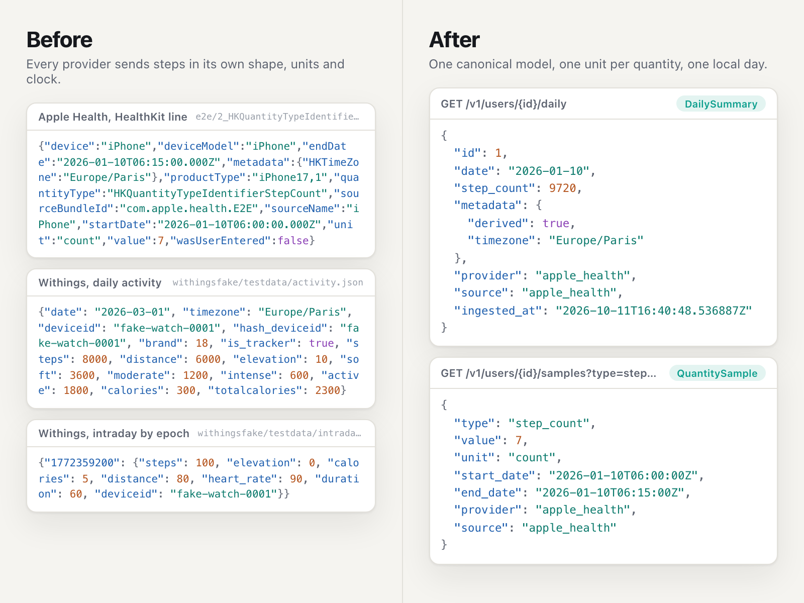
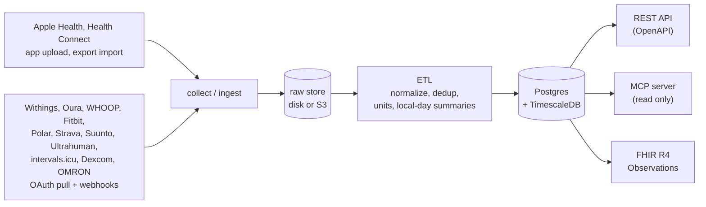
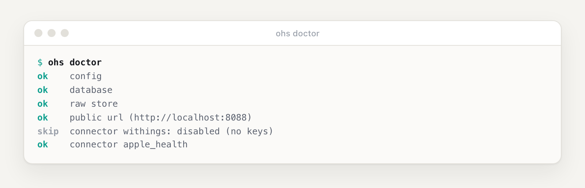
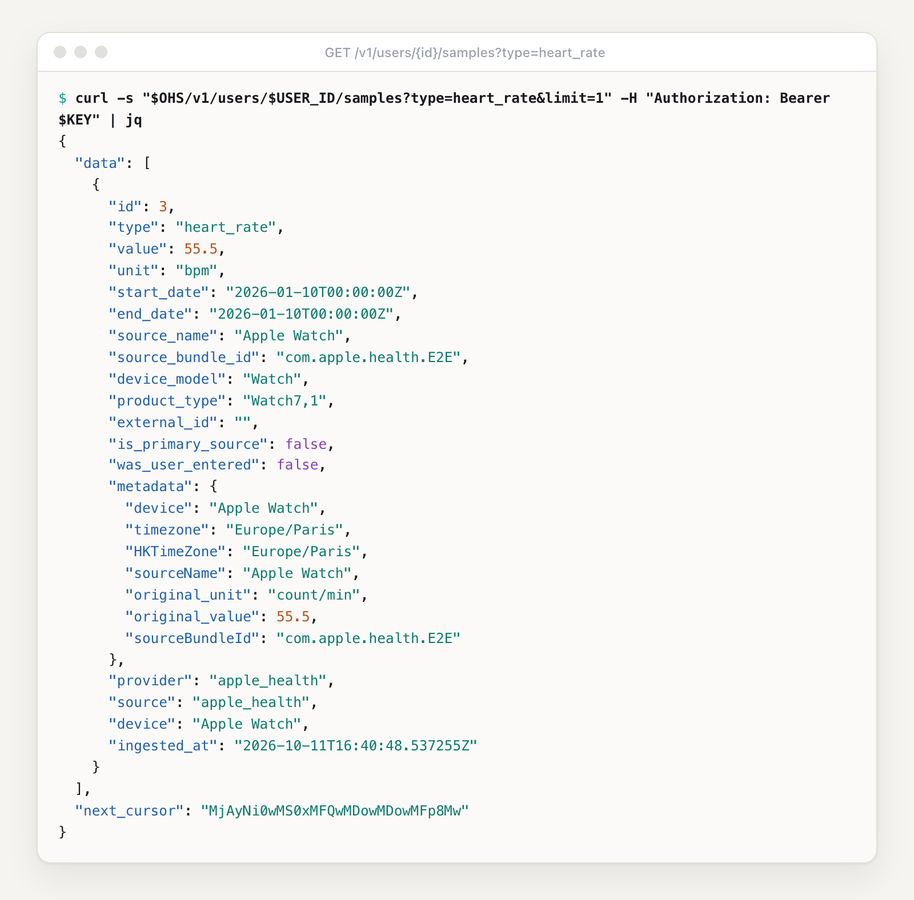
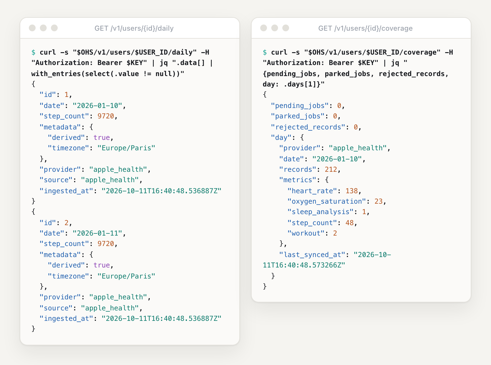
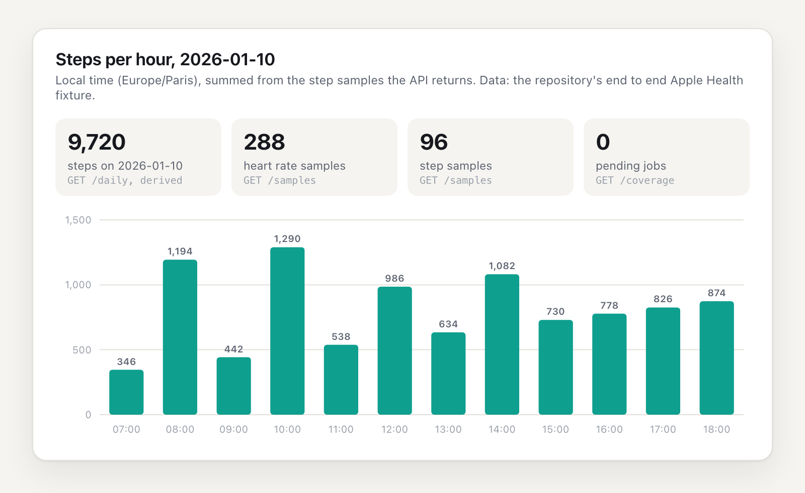
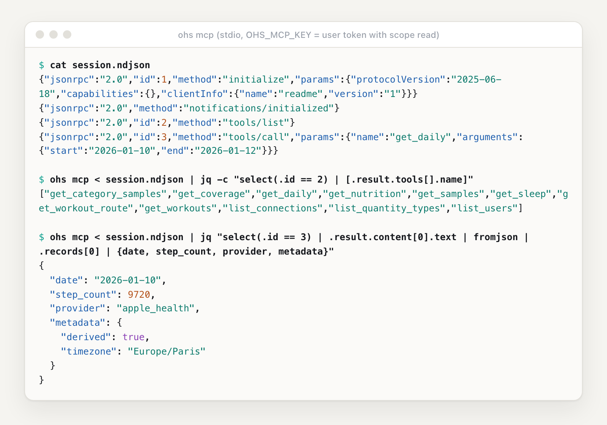

<a href="#quickstart">
<picture>
  <source media="(prefers-color-scheme: dark)" srcset="docs/assets/readme/hero-dark.png">
  
</picture>
</a>

<div align="center">

# Open Health Sync

### One open API for wearable and health data. On your own server.

Apple Health, Withings, Oura, WHOOP, Fitbit, Health Connect, Dexcom, OMRON and five more.<br>
One clean model out, over REST, FHIR R4 and a read-only MCP server for AI agents.<br>
Free, one Go binary plus Postgres, runs on a Raspberry Pi.

[](https://github.com/soma-intelligence/open-health-sync/actions/workflows/ci.yml)
[](https://github.com/soma-intelligence/open-health-sync/releases)
[](https://github.com/soma-intelligence/open-health-sync/releases)

[](go.mod)
[](LICENSE)

<p>
<a href="docs/connectors/apple-health.md"></a>
<a href="docs/connectors/withings.md"></a>
<a href="docs/connectors/oura.md"></a>
<a href="docs/connectors/whoop.md"></a>
<a href="docs/connectors/strava.md"></a>
<a href="docs/connectors/polar.md"></a>
<a href="docs/connectors/fitbit.md"></a>
<a href="docs/connectors/suunto.md"></a>
<a href="docs/connectors/ultrahuman.md"></a>
<a href="docs/connectors/intervals-icu.md"></a>
<a href="docs/connectors/health-connect.md"></a>
<a href="docs/connectors/dexcom.md"></a>
<a href="docs/connectors/omron.md"></a>
<a href="docs/connectors/README.md"></a>
</p>

```bash
docker pull ghcr.io/soma-intelligence/open-health-sync:0.1.0
```

[**Quickstart**](#quickstart) &nbsp;&middot;&nbsp; [Roadmap](#roadmap-at-a-glance) &nbsp;&middot;&nbsp; [Use cases](#what-you-can-build) &nbsp;&middot;&nbsp; [Why](#why) &nbsp;&middot;&nbsp; [Features](#features) &nbsp;&middot;&nbsp; [How it works](#how-it-works) &nbsp;&middot;&nbsp; [MCP](#connect-an-ai-agent-mcp) &nbsp;&middot;&nbsp; [FAQ](#faq)

<sub>If it saves you one more parser, a <a href="https://github.com/soma-intelligence/open-health-sync/stargazers">⭐ star</a> helps other developers find it. Questions and ideas: <a href="https://github.com/soma-intelligence/open-health-sync/discussions">Discussions</a>.</sub>

<sub><b>v0.1.0, early preview.</b> APIs, configuration and schema may change in any 0.x release.</sub>

</div>

Open Health Sync (`ohs`) is a self-hosted ingestion and normalization layer for health data. It
pulls from providers, accepts uploads from phones, stores each payload verbatim, maps it to one
canonical model with one set of units, and serves it over a REST API and a read-only MCP server.
It is not a dashboard, a coaching app or a hosted service, and it is not a medical device or
clinical software.

<table>
<tr>
<td width="33%" valign="top">

**🔌 Thirteen sources, one model**<br>
Every provider maps into the same records, with one unit per quantity (UCUM, LOINC). Heart rate
is `bpm`, whatever the source called it. All thirteen ship in v0.1.0.

</td>
<td width="33%" valign="top">

**⚡ Always current**<br>
Provider webhooks trigger a pull of just what changed. A backstop pull catches anything lost,
and `/freshness` says how up to date each source is.

</td>
<td width="33%" valign="top">

**🧾 Nothing thrown away**<br>
Every payload is kept verbatim on disk or S3. Fix a mapper, re-process a user from the raw
files. Re-sent uploads are de-duplicated.

</td>
</tr>
<tr>
<td valign="top">

**🤖 Ready for AI agents**<br>
A read-only MCP server: a person points their own agent at their own data, with a token that
can only read.

</td>
<td valign="top">

**🏥 Standards out**<br>
An OpenAPI 3.1 REST API, plus FHIR R4 Observations checked against the official HL7 validator.

</td>
<td valign="top">

**🔒 Yours, and erasable**<br>
Self-hosted, no call home. `DELETE /v1/users/{id}` is a hard delete of rows and raw files.
Provider deletions are honored too.

</td>
</tr>
</table>

## Roadmap at a glance

✅ in v0.1.0 &nbsp;·&nbsp; 🔜 on `main`, ships in the next release &nbsp;·&nbsp; 🛠 planned

| | Outputs and integrations | | Sources |
|:---:|---|:---:|---|
| ✅ | REST API (OpenAPI 3.1), read-only MCP server | ✅ | Apple Health, Withings |
| ✅ | FHIR R4 (Observations, checked with the HL7 validator) | ✅ | Oura, WHOOP, Polar, Strava |
| ✅ | Open mHealth output ([docs](docs/open-mhealth.md)) | ✅ | Fitbit, Suunto, Ultrahuman, intervals.icu |
| ✅ | CSV and Parquet exports ([docs](docs/exports.md)) | ✅ | Dexcom (CGM), OMRON |
| ✅ | Outgoing webhooks ([docs](docs/webhooks.md)) | ✅ | Health Connect (Android app upload) |
| ✅ | Background sync and `/freshness` | ✅ | Health app export import |
| ✅ | Prometheus metrics and OpenTelemetry traces, off by default ([docs](docs/observability.md)) | | |
| ✅ | A merged view across sources, with priorities per user and metric ([docs](docs/api.md#several-sources-of-one-metric-the-merged-view)) | | |
| ✅ | Read-only admin console at `/console` ([docs](docs/console.md)) | | |
| ✅ | Consent per user, source and category, with a revocation webhook ([docs](docs/consent.md)) | | |
| ✅ | Complete per-user archive for data portability ([docs](docs/exports.md#complete-user-archive-data-portability)) | | |
| ✅ | Append-only audit log of every authenticated request, read with `GET /v1/audit` ([docs](docs/audit-log.md)) | | |
| ✅ | Backup and restore scripts, tested in CI ([docs](docs/backup-and-restore.md)) | | |
| ✅ | Kubernetes through a Helm chart ([docs](docs/helm.md)) | | |
| ✅ | Deploy templates for Render, Fly.io and Railway ([docs](docs/deploy-platforms.md)) | | |
| ✅ | Hosted connect page: your app name and logo, one button per source ([docs](docs/connect-page.md)) | | |
| ✅ | Erase one source's data for a user on disconnect, or for Apple Health and Health Connect | | |
| 🔜 | Twelve MCP prompts on training, sleep and recovery, and an agent skill ([docs](docs/mcp.md#prompts)) | | |
| 🔜 | Server SDKs for TypeScript and Python, and a Postman collection ([docs](docs/server-sdks.md)) | | |
| 🔜 | Rate limits on the provider-facing routes ([docs](docs/self-hosting.md#rate-limits)) | | |
| 🔜 | Images and `checksums.txt` signed with cosign, keyless ([verify](SECURITY.md#verifying-releases)) | | |
| 🔜 | Online rotation of the encryption key ([docs](docs/key-rotation.md)) | | |
| ✅ | Personal mode (`ohs admin personal setup`) and [eight small Python recipes](docs/recipes/README.md) on your own data | 🛠 | Health records (EHR) through SMART on FHIR |
| ✅ | [Kotlin, Swift, React Native and Flutter SDKs](docs/sdks/README.md) and example apps | 🛠 | Garmin, Coros |

A line moves up only when its release is published. Details per source:
[docs/connectors](docs/connectors/README.md).

## What you can build

- **A health app backend.** Your iOS app uploads HealthKit data, your users connect their
  Oura, WHOOP or Withings accounts (through a hosted connect page with your logo), and your app
  reads one API instead of thirteen.
- **An AI agent over your own data.** Run it at home, connect your devices, and give your desktop
  agent a read-only view of your sleep, workouts and heart rate through MCP.
- **A study that collects from participants' wearables.** Raw payloads kept for audit, hard
  deletes for withdrawals, FHIR R4 out for the analysis side.
- **A personal data archive.** Load years of history from the Health app export in one command,
  and keep it on a machine you own.
- **Small tools on your own data.** `ohs admin personal setup` gives you one instance for
  yourself, and the [recipes](docs/recipes/README.md) add a sleep report, a heart trend, a weekly
  digest, a dashboard and more, each a single Python file with no dependency.

## Why

Every health source speaks its own dialect. Apple Health sends one JSON line per HealthKit
sample, heart rate in `count/min`, oxygen saturation as a fraction. Withings sends a daily
activity object keyed by date, and intraday series keyed by Unix epoch. Each one has its own
idea of a day, a device and a duplicate.

So teams write a script per provider: a parser, a table, a cron job. It works until the second
provider, the first re-sent upload, the first mapper bug that needs a backfill, or the first
person who asks you to delete everything you hold about them.

Open Health Sync is that layer, written once, with the boring parts done properly.

<picture>
  <source media="(prefers-color-scheme: dark)" srcset="docs/assets/readme/before-after-dark.png">
  
</picture>

| | DIY script per provider | Open Health Sync |
| --- | :---: | :---: |
| Add a source | a new parser, new tables, a new cron job | a connector that maps into the same model |
| Units | whatever each API sends | one unit per quantity, the original value and unit kept in `metadata` |
| "Today" | UTC, or the provider's clock | the local calendar day of the record's time zone |
| A re-sent upload | stored twice | answered `200` with `"duplicate": true`, records de-duplicated by content hash |
| Raw payloads | parsed, then thrown away | kept verbatim on disk or S3, so a user can be re-processed after a fix |
| Is it done? | guess, or check the logs | `GET /coverage`: `pending_jobs`, `parked_jobs`, `rejected_records` |
| Is it current? | a cron job and hope | webhook-triggered pulls, a backstop pull, `GET /freshness` per source |
| A record deleted at the provider | stays in your tables | deleted here too, when the provider reports it |
| New data arrived | poll on a timer | a signed webhook (`data.written`) names the user, provider and days |
| A crash mid-run | rerun the script and hope | Postgres queue, retries with backoff, parked after 5 attempts |
| Provider OAuth tokens | a plain column or a `.env` | sealed with AES-256-GCM under `OHS_ENCRYPTION_KEY` |
| Delete a user | grep across tables and buckets | `DELETE /v1/users/{id}`, then poll `GET /v1/deletions/{job_id}` |
| Erase one provider's data | the same grep, filtered by hand | `DELETE /v1/users/{id}/connections/{provider}?delete_data=true`, or `DELETE /v1/users/{id}/data/{provider}` for a device |
| Let an AI agent read it | build an integration | read-only MCP server, `ohs mcp` for desktop agents |

## Features

- **One canonical model.** Quantity samples, category samples, sleep sessions and phases,
  workouts and routes, nutrition, daily summaries. Each record carries its provenance:
  `provider`, `source`, `device` and `ingested_at`.
- **One unit per quantity.** Quantity names come with UCUM units and LOINC codes
  ([data model](docs/data-model.md)). Heart rate is `bpm` whatever the source called it.
- **Raw payloads are kept.** Every upload and pull lands in the raw store (local folder or any
  S3 compatible bucket) before anything else, and is never rewritten. After a mapper fix, any
  user can be re-processed from the raw files ([how](docs/self-hosting.md#operating-notes)).
- **Local days, not UTC days.** Daily summaries are per local calendar day, from the record's
  time zone. When a provider sends no daily summary, step, energy and distance totals are
  derived from samples.
- **Idempotent uploads.** Each Apple Health part is stored under its day, batch and part
  number. Re-sending the same bytes answers `200` with `"duplicate": true`; other bytes under a
  taken key are refused, never written over. Records are de-duplicated by content hash.
- **Always current, without a sync button.** Provider webhooks trigger a pull of just what
  changed, ahead of any routine work; a backstop pull every 6 hours (hourly when webhooks are
  silent) catches anything lost. `GET /v1/users/{id}/freshness` says how up to date each source
  is ([background sync](docs/background-sync.md)).
- **Know when it's processed.** The coverage report counts records per provider and local day,
  plus jobs still pending, jobs parked after their retries, and lines that were not stored.
- **Real erasure.** `DELETE /v1/users/{id}` removes the user's raw files and every row, then the
  user. Not a soft flag. When a provider reports that a record was deleted (Oura, WHOOP,
  Strava), it is deleted here too. Disconnecting a source with
  `?delete_data=true` erases everything that source sent for the user (records, raw files, sync
  history), and `DELETE /v1/users/{id}/data/{provider}` does the same for Apple Health or Health
  Connect. `OHS_RETENTION_DAYS` drops raw files and normalized data past an age.
- **Consent per category.** Each user grants or refuses each source per data category (sleep,
  heart, location, glucose and so on). Data not granted is dropped before it is stored, revoking
  a category deletes what was stored, and `consent.granted` and `consent.revoked` webhooks tell
  your server ([guide](docs/consent.md)).
- **One-call user archive.** `GET /v1/users/{id}/archive` returns everything held about one
  person as a single zip, for access and portability requests
  ([docs](docs/exports.md#complete-user-archive-data-portability)).
- **Multi-tenant.** Tenant API keys (`ohs_sk_`) for your server, short-lived scoped user tokens
  (`ohs_ut_`, scopes `upload` and `read`) for one person's app or agent. Keys and tokens are
  stored as SHA-256 hashes.
- **Outgoing webhooks.** Your server is told when a sync writes or deletes data, a user is
  erased or a connection needs the user again. Signed per Standard Webhooks, retried for
  about 28 hours, and thin: no health value ever leaves in a payload
  ([guide](docs/webhooks.md)).
- **Read-only MCP for AI agents.** A person can point their own agent at their own data, with a
  token that can only read.
- **One binary plus Postgres.** The queue lives in Postgres (`FOR UPDATE SKIP LOCKED`). No
  message broker, cache or worker fleet. The `api`, `collect` and `etl` roles run in one
  process or apart.
- **Runs small.** A Raspberry Pi 5 with 4 GB runs the full stack, with a compose overlay tuned
  for it. Samples older than 30 days are compressed, about 7 times smaller on disk, and
  re-importing history into them stays fast.
- **Open standards.** An OpenAPI 3.1 file describes the API, FHIR R4 Observations are checked
  against the official HL7 validator ([`scripts/fhir-validate.sh`](scripts/fhir-validate.sh)),
  MCP is an open protocol, and `ohs doctor` checks a configuration before you trust it.
- **No scores, no AI inside.** It stops at clean, traceable data. Build insights on top.

### Sources and outputs

Thirteen sources are in v0.1.0. Every other one is planned: on the roadmap, not built yet.
Integration paths, vendor programs and tracking issues for each:
[docs/connectors](docs/connectors/README.md).

| Source | Status | How the data arrives |
|---|---|---|
| Apple Health | ✅ Available | your iOS app uploads HealthKit data with the [Swift SDK](docs/sdks/swift.md#healthkit-sync) or its own code ([contract](docs/connectors/apple-health.md)); `ohs import apple-health` loads a Health app export |
| Withings | ✅ Available | OAuth, scheduled pulls, push notifications ([guide](docs/connectors/withings.md)) |
| Oura | ✅ Available | OAuth, scheduled pulls, webhooks ([guide](docs/connectors/oura.md)) |
| Whoop | ✅ Available | OAuth, scheduled pulls, webhooks ([guide](docs/connectors/whoop.md)) |
| Strava | ✅ Available | OAuth, scheduled pulls, webhook events ([guide](docs/connectors/strava.md)) |
| Polar | ✅ Available | OAuth, scheduled pulls, webhooks ([guide](docs/connectors/polar.md)) |
| Garmin | 🛠 Planned ([#9](https://github.com/soma-intelligence/open-health-sync/issues/9)) | partner program; Garmin has paused new applications ([research notes](docs/connectors/garmin.md)) |
| Fitbit | ✅ Available | Google Health API: OAuth, scheduled pulls, signed webhooks ([guide](docs/connectors/fitbit.md)). Google is not onboarding new projects yet |
| Suunto | ✅ Available | partner program: OAuth, scheduled pulls, signed notifications ([guide](docs/connectors/suunto.md)) |
| Ultrahuman | ✅ Available | Partnership API: OAuth, daily pulls; ring data and M1 glucose ([guide](docs/connectors/ultrahuman.md)) |
| intervals.icu | ✅ Available | OAuth, scheduled pulls, webhooks; activities from Garmin, Wahoo, Zwift, Coros and more, plus daily wellness ([guide](docs/connectors/intervals-icu.md)) |
| Health Connect | ✅ Available | your Android app uploads Health Connect records ([contract](docs/connectors/health-connect.md)) |
| Dexcom | ✅ Available | CGM glucose: OAuth, scheduled pulls ([guide](docs/connectors/dexcom.md)) |
| OMRON | ✅ Available | blood pressure and weight: partner API, OAuth, scheduled pulls ([guide](docs/connectors/omron.md)) |
| FreeStyle Libre | No public API | through Health Connect or Apple Health ([notes](docs/connectors/freestyle-libre.md)) |
| Coros | 🛠 Planned | cloud API, OAuth |
| Samsung Health, Zepp / Amazfit | 🛠 Planned, via Health Connect | their apps write to Health Connect on Android |
| Google Fit | Deprecated by Google | use Health Connect |
| Eight Sleep | No public API | nothing official to build on |

Want one sooner? Connectors are self-contained: read
[writing a connector](docs/writing-a-connector.md) and pick a
[good first issue](https://github.com/soma-intelligence/open-health-sync/issues?q=is%3Aissue%20is%3Aopen%20label%3A%22good%20first%20issue%22).

| Output | Status |
|---|---|
| REST JSON, described by [api/openapi.yaml](api/openapi.yaml) | ✅ Available |
| MCP server, read only ([docs/mcp.md](docs/mcp.md)) | ✅ Available |
| FHIR R4, checked with the official HL7 validator ([docs/fhir.md](docs/fhir.md)) | ✅ Available (Observations, Patient, Device, Provenance, Patient `$everything`) |
| RR intervals and HRV (RMSSD, SDNN, pNN50, mean RR and heart rate) per heartbeat series, over REST and MCP ([docs/hrv.md](docs/hrv.md)) | ✅ Available |
| Menstrual cycles derived from recorded flow, over REST and MCP; no predictions ([docs/menstrual-cycles.md](docs/menstrual-cycles.md)) | ✅ Available |
| Time tags (illness, injury, travel, jet lag, vaccination, medication, alcohol) that give context to the data, over REST, webhooks and MCP ([docs/time-tags.md](docs/time-tags.md)) | ✅ Available |
| Read routes for ECG recordings, which are stored today | 🛠 Planned |
| FHIR R4 bulk export (`$export`) | 🛠 Planned |
| Open mHealth ([docs/open-mhealth.md](docs/open-mhealth.md)) | ✅ Available |
| CSV and Parquet exports ([docs/exports.md](docs/exports.md)) | ✅ Available |
| Outgoing webhooks, signed per Standard Webhooks ([docs/webhooks.md](docs/webhooks.md)) | ✅ Available (data written or deleted, user erased, connection needs reauthorization) |
| Client SDKs: Kotlin, Swift (with HealthKit sync), React Native, Flutter, and example apps for iOS, Android and React Native ([docs/sdks](docs/sdks/README.md)) | ✅ Available (install from this repository; not on package registries) |
| Health records (EHR): lab results, conditions, medications and allergies read through SMART on FHIR, served as FHIR R4 | 🛠 Planned |

## Quickstart

You need Docker with Compose v2.24 or later, plus `curl`, `jq` and `openssl`. Compose pulls the
published image `ghcr.io/soma-intelligence/open-health-sync` (amd64 and arm64).

```sh
git clone https://github.com/soma-intelligence/open-health-sync.git && cd open-health-sync
cp .env.example .env
sed -i.bak "s|^OHS_ENCRYPTION_KEY=.*|OHS_ENCRYPTION_KEY=$(openssl rand -base64 32)|" .env
docker compose --env-file .env -f deploy/docker-compose.yml up -d --wait
docker compose --env-file .env -f deploy/docker-compose.yml run --rm ohs doctor
docker compose --env-file .env -f deploy/docker-compose.yml exec ohs /ohs admin tenant create --name dev
```

`ohs doctor` prints one `ok` or `fail` line per check (configuration, database, raw store,
public URL, connectors); run it again whenever you change `.env`. The last command prints a tenant API key once. Keep it:

```sh
export OHS=http://localhost:8080
export KEY=ohs_sk_...    # the key printed above
```

The API listens on `127.0.0.1` only, so these steps run on the same machine. A phone app,
provider webhooks or another computer need it exposed: put a reverse proxy with TLS in front, or
set `OHS_HTTP_BIND=0.0.0.0` in `.env` for plain http on your network.

No device or provider keys yet? `ohs seed --demo` fills the instance with 90 days of synthetic
data from six overlapping sources and prints a demo API key and calls to try
([docs/demo.md](docs/demo.md)):

```sh
docker compose --env-file .env -f deploy/docker-compose.yml exec ohs /ohs seed --demo
```

Port 8080 taken? Set `OHS_HTTP_PORT` and a matching `OHS_PUBLIC_URL` in `.env` (see
[self-hosting](docs/self-hosting.md#port-and-a-second-install)).

Create an end user and a token the user's app would hold:

```sh
USER_ID=$(curl -s -X POST $OHS/v1/users -H "Authorization: Bearer $KEY" \
  -H 'Content-Type: application/json' -d '{"external_ref":"demo"}' | jq -r .id)
TOKEN=$(curl -s -X POST $OHS/v1/users/$USER_ID/tokens -H "Authorization: Bearer $KEY" \
  -H 'Content-Type: application/json' -d '{"scopes":["upload"]}' | jq -r .token)
```

Upload one Apple Health part (one heart rate reading, gzip compressed):

```sh
DAY=$(date -u +%Y-%m-%d); NOW=$(date -u +%Y-%m-%dT%H:%M:%SZ)
printf '{"quantityType":"HKQuantityTypeIdentifierHeartRate","startDate":"%s","endDate":"%s","value":72,"unit":"count/min","sourceName":"Demo Watch","metadata":{"HKTimeZone":"UTC"}}\n' "$NOW" "$NOW" \
  | gzip | curl -s -X POST $OHS/v1/ingest/apple-health \
    -H "Authorization: Bearer $TOKEN" -H "Content-Type: application/gzip" \
    -H "X-OHS-Type: HKQuantityTypeIdentifierHeartRate" -H "X-OHS-Day: $DAY" \
    -H "X-OHS-Batch: demo1" -H "X-OHS-Part: 0" --data-binary @-
```

Wait until processing is done (`pending_jobs` is 0), then read the normalized sample back:

```sh
curl -s "$OHS/v1/users/$USER_ID/coverage" -H "Authorization: Bearer $KEY"
curl -s "$OHS/v1/users/$USER_ID/samples?type=heart_rate" -H "Authorization: Bearer $KEY"
```

<a id="install-the-ohs-binary"></a>**Install the `ohs` binary on your machine.** The import below and the [MCP setup](#connect-an-ai-agent-mcp)
run `ohs` outside the container. Take the archive for your system from the
[releases page](https://github.com/soma-intelligence/open-health-sync/releases)
(`ohs_<version>_<os>_<arch>.tar.gz`, `os` is `linux` or `darwin`, `arch` is `amd64` or
`arm64`); it unpacks to a folder of the same name:

```sh
tar xzf ohs_*_linux_amd64.tar.gz
sudo install ohs_*_linux_amd64/ohs /usr/local/bin/ohs
ohs version
```

On macOS, clear the quarantine flag first: `xattr -d com.apple.quarantine ohs_*_darwin_*/ohs`.

**Load your existing history.**
On the iPhone, Health app, your picture, *Export All Health Data* gives `export.zip`. Load it
with the user's token (`--dry-run` first counts what it would send):

```sh
OHS_TOKEN=$TOKEN ohs import apple-health export.zip --url $OHS
```

Records, workouts with their routes and ECGs go through the same upload API, in constant memory.
Running it again uploads nothing twice. Details:
[importing an export](docs/connectors/apple-health.md#importing-a-health-app-export).

Data lives in the `pgdata` and `raw` volumes; `docker compose ... down` keeps them.

## How it works



1. **Collect.** Your iOS app posts HealthKit data to `POST /v1/ingest/apple-health` as gzip
   NDJSON parts, with a user token that has the `upload` scope and the headers `X-OHS-Type`,
   `X-OHS-Day`, `X-OHS-Batch` and `X-OHS-Part`. The cloud providers (Withings, Oura, WHOOP, Fitbit and
   the others) are pulled when they send a webhook (only what changed), with a backstop pull on a schedule.
2. **Keep the raw payload.** The part is written to the raw store first, then a job is queued in
   Postgres. The answer names the raw key and whether the part was a duplicate.
3. **Normalize.** The `etl` role maps each line to the canonical model, converts units, drops
   duplicates, attributes source and device, and rolls up daily summaries per local day.
4. **Serve.** Reads are `GET /v1/users/{id}/...` with the tenant key, paged with a cursor. The
   MCP server reads the same data, read only.

Details: [architecture](docs/architecture.md), [API guide](docs/api.md).

### See it run

These are real captures, not mockups: `ohs` 0.0.1 built from this repository, run natively
against TimescaleDB (on port 8088, since 8080 was taken on that machine), with the end to end
Apple Health fixture in [`connectors/applehealth/testdata/e2e`](connectors/applehealth/testdata/e2e)
uploaded as six parts. The fixture's values are synthetic.

<picture>
  <source media="(prefers-color-scheme: dark)" srcset="docs/assets/readme/doctor-dark.png">
  
</picture>

A sample comes back in canonical units, with what the provider sent kept in `metadata`
(`count/min` became `bpm`):

<picture>
  <source media="(prefers-color-scheme: dark)" srcset="docs/assets/readme/samples-dark.png">
  
</picture>

Daily summaries are derived per local day, and the coverage report says when processing is done:

<picture>
  <source media="(prefers-color-scheme: dark)" srcset="docs/assets/readme/daily-coverage-dark.png">
  
</picture>

<picture>
  <source media="(prefers-color-scheme: dark)" srcset="docs/assets/readme/chart-dark.png">
  
</picture>

## Connect an AI agent (MCP)

Mint a user token with only the `read` scope (it may live up to 30 days):

```sh
curl -s -X POST $OHS/v1/users/$USER_ID/tokens -H "Authorization: Bearer $KEY" \
  -H 'Content-Type: application/json' -d '{"scopes":["read"],"ttl_seconds":2592000}'
```

Then add `ohs mcp` (stdio) to your desktop agent's `mcpServers` (the binary from
[the install step](#install-the-ohs-binary)):

```json
{
  "mcpServers": {
    "open-health-sync": {
      "command": "/usr/local/bin/ohs",
      "args": ["mcp"],
      "env": { "OHS_MCP_URL": "http://localhost:8080", "OHS_MCP_KEY": "ohs_ut_..." }
    }
  }
}
```

`ohs mcp` holds no data and needs no database: it forwards each message to the `/mcp` endpoint
of an instance. `OHS_MCP_URL` must be `https` unless the host is loopback. Agents that speak
Streamable HTTP can call `/mcp` directly with the bearer token.

On `main` for the next release, the server also lists twelve prompts (`prompts/list`): ready-made
questions about training, sleep and recovery that read the data first and show the numbers
([prompts](docs/mcp.md#prompts), [prompt library](docs/learn/prompts.md)). The same guidance
ships as an agent skill in [`skills/open-health-sync`](skills/open-health-sync/SKILL.md).

<picture>
  <source media="(prefers-color-scheme: dark)" srcset="docs/assets/readme/mcp-dark.png">
  
</picture>

Tools, arguments and paging: [docs/mcp.md](docs/mcp.md).

## Data model

Every source maps into these records (see [docs/data-model.md](docs/data-model.md) for fields
and units):

- **QuantitySample**: one scalar measurement, such as heart rate, steps or SpO2.
- **CategorySample**: a categorical event, such as a stand hour or a menstrual flow entry.
  Menstrual cycles are derived from the flow entries at read time by `/menstrual-cycles`
  ([docs/menstrual-cycles.md](docs/menstrual-cycles.md)).
- **SleepSession** and **SleepPhase**: a night with its duration breakdown, then each stage.
- **Workout** and **RoutePoint**: a session with its metrics, then its GPS track.
- **NutritionLog**: a food or drink entry with its nutrients.
- **ECGRecording** and **ECGVoltageSample**: the recording's metadata, then the voltage trace.
  Stored, not served yet: the read route is planned.
- **HeartbeatSample**: one beat-to-beat (RR) interval. Served with HRV derived per series by
  `/rr-intervals` and `/hrv` ([docs/hrv.md](docs/hrv.md)).
- **DailySummary**: totals per local day, from the provider or rolled up from samples.
- **Observation**: a generic coded fact for the long tail. No connector writes it yet.

## Deploy

- **Compose with the published image.** `deploy/docker-compose.yml`, as in the quickstart. Pin
  the tag with `OHS_VERSION` (there is no `latest` while 0.x). See
  [self-hosting](docs/self-hosting.md).
- **Raspberry Pi 5.** Add the overlay `deploy/docker-compose.pi.yml` (smaller Postgres buffers,
  memory limits). See [Raspberry Pi 5](docs/self-hosting.md#raspberry-pi-5-4-gb).
- **S3 raw store.** Add `deploy/docker-compose.s3.yml`, or point `OHS_RAW_STORE` at any S3
  compatible bucket. See [S3](docs/self-hosting.md#s3-compatible-raw-store).
- **Backup and restore.** `scripts/backup.sh` writes one archive with the
  database, the raw store and the schema version; `scripts/restore.sh` puts it back. CI destroys
  and restores a stack on every pull request. See [backup and restore](docs/backup-and-restore.md).
- **Release binaries.** Linux and macOS, amd64 and arm64, with `checksums.txt`, on the
  [releases page](https://github.com/soma-intelligence/open-health-sync/releases). Bring your
  own Postgres with TimescaleDB and run `ohs doctor`, then `ohs up` (migrate, then serve). Each
  archive unpacks to `ohs_<version>_<os>_<arch>/ohs` ([install](#install-the-ohs-binary)). The
  macOS binaries are not signed yet: clear the quarantine flag with `xattr -d com.apple.quarantine`.
  From the next release, the image and `checksums.txt` are signed with cosign
  ([verifying releases](SECURITY.md#verifying-releases)).
- **Build from source.** Go 1.26: `make build` gives `bin/ohs`. For compose, add
  `deploy/docker-compose.build.yml`, which needs `docker buildx`; without it, see
  [build from source](docs/self-hosting.md#build-from-source).

## FAQ

<details>
<summary><b>Who sees my data?</b></summary>

Only whoever runs the instance. Open Health Sync is self-hosted software, not a service: there
is no account to create with us, no analytics and no call home. The server talks to the
providers you enable (the ones whose keys you set) and to your own database and raw store.
Logs never contain tokens, keys or health values.

</details>

<details>
<summary><b>Where does the data live?</b></summary>

In two places you control: Postgres with TimescaleDB (connections and jobs in the `ohs_sync`
schema, normalized records in `ohs_data`) and the raw store, a local folder or an S3 compatible
bucket. With compose, those are the `pgdata` and `raw` volumes. Back them up together, with
`OHS_ENCRYPTION_KEY`.

</details>

<details>
<summary><b>Is it HIPAA or GDPR compliant?</b></summary>

No software is compliant on its own, and Open Health Sync is not certified, audited or covered
by a business associate agreement. What it gives you: data stays on infrastructure you choose,
`DELETE /v1/users/{id}` is a hard delete of raw files and rows (useful for erasure requests),
erasing one source's data for a user is a single call,
consent is kept per source and data category and enforced on every write,
`GET /v1/users/{id}/archive` gives one person everything held about them in a zip,
`OHS_RETENTION_DAYS` enforces a retention period, every query is scoped to a tenant and a user,
keys and tokens are stored hashed, and provider OAuth tokens are encrypted with AES-256-GCM
under a key that can be rotated online (next release, [key rotation](docs/key-rotation.md)).
Health records themselves are not encrypted by `ohs`: use disk or database encryption, TLS in
front of the API, and your own access controls. Whether a deployment meets HIPAA, GDPR or any
other rule depends on how you run it.

</details>

<details>
<summary><b>What does it cost?</b></summary>

Nothing. The server is free and open source. You pay for wherever you run it, which can be a
Raspberry Pi 5 with 4 GB. Each cloud provider (Withings, Oura, WHOOP, Fitbit and the others) needs your
own developer application, registered with the vendor.

</details>

<details>
<summary><b>Which devices does it work with?</b></summary>

Anything that writes to Apple Health (Apple Watch, iPhone, and the apps and devices that sync
into HealthKit), through an iOS app that uploads it: the [Swift SDK](docs/sdks/swift.md#healthkit-sync) reads
HealthKit and uploads what changed, or your app implements the
[upload contract](docs/connectors/apple-health.md) itself. Without an app, `ohs import apple-health`
loads the export the Health app writes, history included. Withings scales, watches and sleep devices
through the user's Withings account. Oura rings, WHOOP bands, Polar watches, Strava
activities, Suunto watches, Fitbit devices (through the Google Health API), Ultrahuman rings,
intervals.icu accounts, Dexcom CGMs and OMRON blood pressure monitors and scales work through
the user's own account with each. Fitbit, Suunto, Ultrahuman and OMRON need keys their vendor gives to approved
developers only. On Android, anything that writes to Health Connect (Samsung Health, CGM apps
such as FreeStyle Libre) arrives through an app that uploads it
([contract](docs/connectors/health-connect.md)). Garmin and more are
[planned](docs/connectors/README.md), not available yet, and the
[connector request form](https://github.com/soma-intelligence/open-health-sync/issues/new/choose)
is open.

</details>

<details>
<summary><b>Why AGPL?</b></summary>

So the layer stays open. Anyone can run, study and change it; if you run a modified Open Health
Sync as a network service, you publish your changes under the same license. The client SDKs in
[sdks/](sdks) are AGPL-3.0-only too.

</details>

<details>
<summary><b>Can I use it commercially?</b></summary>

Yes. A company can run it, unmodified or modified, to power its own product. The AGPL only asks
that users who interact with a modified server over the network can get its source. This is not
legal advice: read [LICENSE](LICENSE) or ask your counsel.

</details>

<details>
<summary><b>Is it a medical device?</b></summary>

No. It moves and normalizes data. It does not diagnose, score or advise, and it is not clinical
software.

</details>

## Status and roadmap

v0.1.0 is the latest release. It adds the Oura, WHOOP, Strava, Polar, Fitbit, Suunto, Ultrahuman, intervals.icu,
Dexcom, OMRON and Health Connect connectors, FHIR R4 and Open mHealth output, CSV and Parquet exports, outgoing
webhooks, Health app export import, background sync, sample compression, RR intervals and HRV, menstrual cycles, time tags, per-source erasure, a merged view across sources, backup and restore,
the hosted connect page, sync history and connection health, personal mode with its recipes, an audit log, consent per source and
category, a complete user archive, a read-only admin console and a Helm chart for Kubernetes. What changed: [CHANGELOG.md](CHANGELOG.md). Install and upgrade notes and the full list
of limitations: [release notes](docs/release-notes/v0.1.0.md).

Known limitations:

- After a hard kill, a job that was in flight is picked up again only after its 10 minute
  visibility timeout.
- One database and one raw store per instance; no multi-region replication.
- FHIR R4 has no bulk export (`$export`) yet.
- The client SDKs are 0.1.0 and not on package registries yet; install them from this
  repository. Reading Health Connect from the Kotlin SDK is planned.

Next: more connectors, standard outputs (more FHIR R4 resources), then
Health Connect reading in the Kotlin SDK, then health records (EHR) through SMART on FHIR. Requests are welcome as GitHub issues, including the connector request form.

## Documentation

- [Self-hosting](docs/self-hosting.md): configuration, images, Raspberry Pi, S3, operating notes.
- [Security model](docs/security-model.md) and [hardening checklist](docs/hardening.md): what is
  protected and how, and what to set before an instance holds real people's data.
- [API guide](docs/api.md) and the [OpenAPI file](api/openapi.yaml), the source of truth.
- [MCP server](docs/mcp.md): tools, prompts, credentials, desktop and remote agents.
- [FHIR R4 output](docs/fhir.md): the user's records as Observations, the mapping and its limits.
- [Outgoing webhooks](docs/webhooks.md): events, signatures, retries and the endpoint routes.
- [Data model](docs/data-model.md): every canonical type and quantity name, with units.
- [Client SDKs](docs/sdks/README.md): [Kotlin](docs/sdks/kotlin.md), [Swift](docs/sdks/swift.md),
  [React Native](docs/sdks/react-native.md), [Flutter](docs/sdks/flutter.md).
- [Server SDKs](docs/server-sdks.md): TypeScript and Python clients for your backend, and a
  [Postman collection](docs/api-collections.md) (next release).
- [Example apps](examples/README.md): iOS (HealthKit), Android and React Native, built on the SDKs.
- [Architecture](docs/architecture.md): roles, pipeline, storage, reliability.
- Connectors: [supported and planned sources](docs/connectors/README.md),
  [Apple Health](docs/connectors/apple-health.md),
  [Withings](docs/connectors/withings.md), [Oura](docs/connectors/oura.md),
  [WHOOP](docs/connectors/whoop.md), [Strava](docs/connectors/strava.md),
  [Polar](docs/connectors/polar.md), [writing your own](docs/writing-a-connector.md).
- [Background sync](docs/background-sync.md): webhooks, backstop pulls, freshness.
- [Backup and restore](docs/backup-and-restore.md): one archive with the database and raw store, and how to put it back.
- [Connect page](docs/connect-page.md): a hosted page where your users connect their sources, then return to your app.
- [Admin console](docs/console.md): a read-only page for users, connections, freshness and webhook deliveries.
- [Recipes](docs/recipes/README.md): personal setup and small tools on your own data.
- [RR intervals and HRV](docs/hrv.md): beat-to-beat intervals and the HRV derived from them.
- [Menstrual cycles](docs/menstrual-cycles.md): cycles derived from recorded flow, without predictions.
- [Time tags](docs/time-tags.md): intervals such as an illness or a trip that give context to the data.

## Contributing

Issues and pull requests are welcome. Three ways in, from five minutes to a weekend:

- **Own a wearable?** Record your account in about five minutes with `make record PROVIDER=oura`
  (or any other source). The recorder anonymizes on your machine and CI replays the file on every
  change: pick a source in [#60](https://github.com/soma-intelligence/open-health-sync/issues/60),
  and see [recording a connector](docs/connectors/recording.md).
- **Pick a [good first issue](https://github.com/soma-intelligence/open-health-sync/issues?q=is%3Aissue%20is%3Aopen%20label%3A%22good%20first%20issue%22)**:
  docs, a recipe, a CLI command or a deploy template, each scoped to one PR.
- **Add a provider.** Connectors are self-contained: start with
  [writing a connector](docs/writing-a-connector.md).

Read [CONTRIBUTING.md](CONTRIBUTING.md) and the [code of conduct](CODE_OF_CONDUCT.md) first. Every
first-time contributor gets a review within 48 hours.

```sh
make setup        # git hooks
make build        # bin/ohs
make test         # unit tests
make integration  # needs Docker (testcontainers)
```

### Contributors

<a href="https://github.com/soma-intelligence/open-health-sync/graphs/contributors">
  
</a>

## Security

Report vulnerabilities privately, as described in [SECURITY.md](SECURITY.md). Never paste health
data, keys or tokens in a public issue.

## License

The server is AGPL-3.0-only, see [LICENSE](LICENSE). If you run a modified Open Health Sync as a
service, you publish your changes. The client SDKs in [sdks/](sdks) are under the same license.
