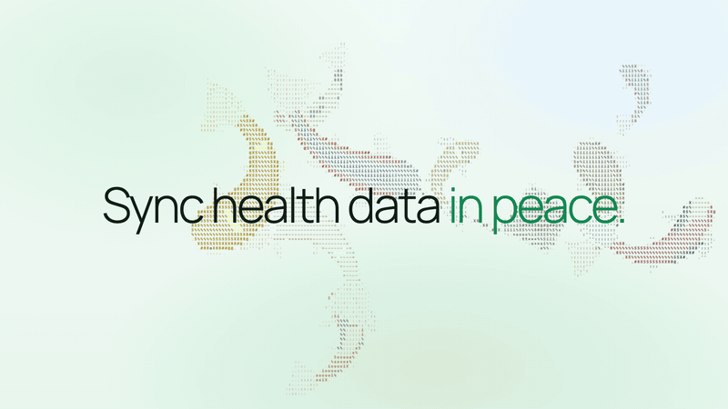
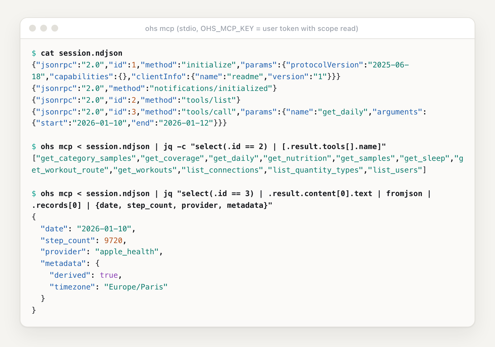

<p align="center">
<picture>
  <source media="(prefers-color-scheme: dark)" srcset="docs/assets/readme/koi-hero-dark.gif">
  
</picture>
</p>

<div align="center">

# Open Health Sync

**One API for all your health data. Free, open source, on your own server.**

[](https://github.com/soma-intelligence/open-health-sync/actions/workflows/ci.yml)
[](https://github.com/soma-intelligence/open-health-sync/releases)
[](LICENSE)

</div>

Open Health Sync is an open source, self-hosted health data aggregator for developers and
individuals that collects data from wearables and health apps (Apple Health, Health Connect,
Garmin, Oura, WHOOP, Fitbit, Withings, Polar, Strava, Dexcom and more) and serves it back in one
data model through a REST API, FHIR R4, Open mHealth, signed webhooks, CSV and Parquet exports and
a read-only MCP server. It is one Go binary plus Postgres, licensed AGPL-3.0, and runs on Linux
and macOS, in Docker, on Kubernetes or on a Raspberry Pi 5. It is a free alternative to hosted
wearable APIs such as Terra. The project is pre-1.0 (version 0.3.0): any release may change the
API, the configuration or the database schema. It is not a medical device.

## At a glance

| | |
|---|---|
| What it is | Self-hosted health and wearable data aggregator (prefix `ohs`) |
| License | [AGPL-3.0-only](LICENSE) |
| Language and stack | Go 1.26, PostgreSQL with TimescaleDB, `net/http` router |
| Runs on | Docker images for `linux/amd64` and `linux/arm64`; release binaries for Linux and macOS (amd64, arm64); Helm chart; Render, Fly.io, Railway; Raspberry Pi 5 (4 GB) |
| Version | 0.3.0 (see [CHANGELOG](CHANGELOG.md) and [releases](https://github.com/soma-intelligence/open-health-sync/releases)) |
| Sources | 18 available: Apple Health, Health Connect, Withings, Oura, WHOOP, Strava, Polar, Fitbit, Suunto, Ultrahuman, intervals.icu, Dexcom, OMRON, Garmin, Eight Sleep, Xiaomi, FIT/GPX/TCX activity files, Bluetooth health devices ([list](docs/connectors/README.md)) |
| Outputs | REST API ([OpenAPI](api/openapi.yaml)), FHIR R4, Open mHealth, signed webhooks, CSV, Parquet, read-only MCP server, SQL on your own Postgres |
| SDKs | Swift, Kotlin, React Native, Flutter (apps); TypeScript and Python (servers) |
| Install | `docker compose --env-file .env -f deploy/docker-compose.yml up -d --wait` |
| Homepage | [openhealthsync.com](https://openhealthsync.com) |

## What it does

Every health app and wearable sends data in its own format. Open Health Sync collects it all and
gives it back in one clean format, through one API.

- **In:** Apple Health, Health Connect, Garmin, Oura, WHOOP, Fitbit, Withings, Polar, Strava,
  Dexcom, [lab results](docs/labs.md) and [more](docs/connectors/README.md).
- **Out:** a REST API, FHIR R4, Open mHealth, signed webhooks, an [event stream](docs/events-stream.md),
  CSV and Parquet, native SDKs, and an [MCP server](docs/mcp.md) so an AI agent can read your data.
- **Runs anywhere:** one program plus Postgres, even on a Raspberry Pi. Your data stays with you,
  its health values sealed per user at rest ([security model](docs/security-model.md)).

## Features

**Collect**

- Cloud connectors with OAuth, scheduled pulls and provider webhooks: Oura, WHOOP, Withings,
  Fitbit (Google Health API), Garmin (Health API, with your own Garmin business app), Polar,
  Strava, Suunto, Ultrahuman, intervals.icu, Dexcom, OMRON, Eight Sleep. Each provider has its own
  [sync policy](docs/background-sync.md#sync-policy-per-provider).
- On-device stores: your iOS app uploads HealthKit data to `POST /v1/ingest/apple-health`, your
  Android app uploads Health Connect data to `POST /v1/ingest/health-connect`.
- File imports with history: `ohs import apple-health` (the Health app's `export.zip`),
  `ohs import mi-fitness` (Xiaomi data copy), `ohs import files` (FIT, GPX, TCX).
- Bluetooth health devices (heart rate straps, blood pressure cuffs, scales, glucose meters,
  thermometers, pulse oximeters) through the [`ohs-bridge`](docs/bridge.md) desktop bridge or the
  Swift and Kotlin SDKs.
- A [hosted connection page](docs/connect-page.md) your users open to link their accounts.

**Store and normalize**

- Every payload kept verbatim in a raw store (local disk or S3 compatible), so a mapping fix can
  re-process history.
- One canonical [data model](docs/data-model.md): samples, categories, sleep with stages,
  workouts with routes, nutrition, ECG, heartbeat series and daily summaries, one unit per
  quantity with UCUM units and LOINC codes.
- A merged view that keeps one source per figure when several devices measured the same thing,
  with per-user [source priorities](docs/api.md#several-sources-of-one-metric-the-merged-view).
- RR intervals and [HRV](docs/hrv.md), [menstrual cycles](docs/menstrual-cycles.md),
  [time tags](docs/time-tags.md) and [self reports](docs/self-reports.md).

**Serve**

- REST reads such as `GET /v1/users/{id}/daily`, `/sleep`, `/workouts`, `/samples`, `/coverage`
  ([API guide](docs/api.md)).
- [FHIR R4](docs/fhir.md) Observation, Patient, Device and Provenance, plus `$everything`,
  checked with the official HL7 validator in CI.
- [Open mHealth](docs/open-mhealth.md) data points at `GET /v1/users/{id}/omh/data-points`.
- [CSV and Parquet exports](docs/exports.md) and a complete per-user archive.
- [Signed outgoing webhooks](docs/webhooks.md) with retries, replay and a delivery log.
- A read-only [MCP server](docs/mcp.md) over stdio (`ohs mcp`) or Streamable HTTP (`/mcp`), with
  tools such as `get_daily`, `get_sleep` and `get_samples`.
- [Share links](docs/share-links.md) a person can send to their clinician.

**Operate**

- Multi-tenant: several teams on one instance, each with its own API keys and provider keys
  ([admin API](docs/admin-api.md)).
- [Admin console](docs/console.md), [first-run setup in the browser](docs/setup.md),
  `ohs doctor`, Prometheus metrics and traces ([observability](docs/observability.md)).
- Per-source [consent](docs/consent.md), one-call user deletion, an [audit log](docs/audit-log.md),
  encrypted provider tokens and [key rotation](docs/key-rotation.md).
- [Backup and restore](docs/backup-and-restore.md) scripts, tested end to end.

<picture>
  <source media="(prefers-color-scheme: dark)" srcset="docs/assets/readme/mcp-dark.png">
  
</picture>

## Try it

<a id="quickstart"></a>You need Docker.

```sh
git clone https://github.com/soma-intelligence/open-health-sync.git && cd open-health-sync
cp .env.example .env
sed -i.bak "s|^OHS_ENCRYPTION_KEY=.*|OHS_ENCRYPTION_KEY=$(openssl rand -base64 32)|" .env
sed -i.bak "s|^POSTGRES_PASSWORD=.*|POSTGRES_PASSWORD=$(openssl rand -hex 24)|" .env
docker compose --env-file .env -f deploy/docker-compose.yml up -d --wait
docker compose --env-file .env -f deploy/docker-compose.yml exec ohs /ohs seed --demo
```

The last command loads 90 days of sample data and prints an API key and calls to try.

Or run it on a hosting platform, no server of your own:

[](https://render.com/deploy?repo=https://github.com/soma-intelligence/open-health-sync)

Fly.io and Railway steps are in [Deploy on a platform](docs/deploy-platforms.md).

<a id="install-the-ohs-binary"></a>Next steps: [API guide](docs/api.md),
[self-hosting](docs/self-hosting.md), [releases](https://github.com/soma-intelligence/open-health-sync/releases).

Other ways to run it:

- Release binaries for Linux and macOS, with `checksums.txt` signed with cosign
  ([images and architectures](docs/self-hosting.md#images-and-architectures)).
- Kubernetes with the Helm chart in `deploy/helm/ohs` ([Helm guide](docs/helm.md)).
- A Raspberry Pi 5 with `deploy/docker-compose.pi.yml` ([guide](docs/how-to/raspberry-pi.md)).
- From source: `make build` writes `bin/ohs` (Go 1.26).

## Build an app

- **[SDKs](docs/sdks/README.md):** Swift, Kotlin, React Native and Flutter for the app,
  [TypeScript and Python](docs/server-sdks.md) for your backend. The Swift SDK reads HealthKit and
  the Kotlin SDK reads Health Connect; the React Native and Flutter SDKs read both through a native
  module built on those two. All four are at 0.1.0 and installed from this repository.
- **[Example apps](examples/README.md):** iOS, Android, React Native and a web backend.
- **[Connection page](docs/connect-page.md):** a hosted page where a user connects Oura, WHOOP,
  Withings and the other cloud sources.
- **[Console](docs/console.md):** a web console to turn providers on, add users and watch the
  pipeline. Off by default: set `OHS_CONSOLE=true`.
- **[Webhooks](docs/webhooks.md):** a signed call to your server when a user's data changes.

## Don't want to run a server?

<a id="hosted-beta"></a>Use the [free hosted beta](https://app.openhealthsync.com/portal/signup?utm_source=github&utm_medium=readme&utm_campaign=section):
same API, nothing to install. Test data only for now: see
[what the hosted beta does with data](docs/hosted-beta.md).

## How it works

One binary, `ohs`, runs up to three roles (`OHS_ROLES`, default `api,collect,etl`) against one
Postgres database with TimescaleDB:

1. **collect** pulls each provider on its schedule and on its push notifications, and refreshes
   OAuth tokens.
2. **api** serves the REST API, device uploads, OAuth callbacks, inbound provider hooks, MCP,
   health and metrics.
3. Each payload is written verbatim to the raw store first, then **etl** maps it through the
   provider's connector into canonical records (units, validation, deduplication, attribution)
   in Postgres, and sends outgoing webhooks.

Code layout: `cmd/ohs` (the binary: `up`, `serve`, `migrate`, `doctor`, `admin`, `mcp`, `import`,
`seed`, `version`), `internal/` (core packages), `connectors/` (one package per provider),
`api/openapi.yaml` (the API contract), `bridge/` (the Bluetooth desktop bridge), `sdks/`,
`recipes/` (small Go programs on top of the API), `deploy/`, `docs/` and `docs-site/`. Details:
[architecture](docs/architecture.md).

## Use cases

- Use Open Health Sync to give your app one API for Oura, WHOOP, Garmin, Fitbit, Withings and
  Apple Health data instead of one integration per vendor.
- Use it to load your Apple Health export into PostgreSQL and query it with SQL
  ([guide](docs/how-to/apple-health-to-postgres.md)).
- Use it to let Claude or another MCP client read your own sleep, training and recovery data
  through a read-only token ([guide](docs/how-to/mcp-remote-agent.md)).
- Use it to hand wearable data to a research or clinical system as FHIR R4 or Open mHealth
  ([FHIR guide](docs/how-to/oura-fhir.md)).
- Use it to export WHOOP, Withings, Garmin, Polar or Strava history as CSV or Parquet for a
  spreadsheet, DuckDB or pandas.
- Use it to record Bluetooth heart rate straps, cuffs and scales into a database without a phone
  ([guide](docs/how-to/bluetooth-devices.md)).
- Use it to run a wearable data backend on your own infrastructure when per-user fees or data
  location rule out a hosted API.

## Compared with other options

As of November 2026, from the [comparison pages](docs/compare/README.md) (facts about other
products checked on their own sites on 2026-10-17; check their pages for changes):

| | Kind | License | Where the data lives | Pricing model |
|---|---|---|---|---|
| **Open Health Sync** | Open source, self-hosted | AGPL-3.0 | Your server | Free, you pay for hosting |
| [Terra](docs/compare/terra.md) | Hosted API | Proprietary | Terra's cloud, then your destination | Monthly subscription |
| [Junction](docs/compare/junction.md) (formerly Vital) | Hosted API, plus lab testing | Proprietary | Vendor cloud | Monthly plan |
| [Thryve](docs/compare/thryve.md) | Hosted API, hosted in Europe | Proprietary | Vendor cloud | Monthly plan |
| [Spike API](docs/compare/spike.md) | Hosted API | Proprietary | Vendor cloud | Monthly plan |
| [Sahha](docs/compare/sahha.md) | Hosted API, with health scores | Proprietary | Vendor cloud | Monthly plan |
| [ROOK](docs/compare/rook.md) | Hosted API, with lab and EHR data | Proprietary | Vendor cloud | Monthly plan |
| Shimmer (Open mHealth) | Open source, self-hosted | Apache-2.0 | Your server | Free; no commit since 2021 |

Pick a hosted API when you need a long tail of devices today, Garmin without your own Garmin app,
or your vendor's compliance attestations. Pick Open Health Sync when the data has to stay on your
infrastructure, per-user fees do not fit, or you want standard formats and the source code.

## FAQ

### What is Open Health Sync?

An open source health data aggregator you run yourself. It collects data from 18 sources
(wearables, health apps, files and Bluetooth devices) and serves it in one data model over REST,
FHIR R4, Open mHealth, webhooks, CSV, Parquet and MCP.

### Is there an open source alternative to the Terra API?

Yes. Open Health Sync is an open source, self-hosted alternative to the Terra API, free under
AGPL-3.0. See [Terra API alternative](docs/compare/terra.md) and
[Move from the Terra API](docs/how-to/migrate-from-terra.md).

### Is Open Health Sync free?

Yes. The software is free under AGPL-3.0; you pay for your own server, and for any vendor
developer program that charges (Garmin's Enterprise tier, for example).

### How do I get Oura, WHOOP or Garmin data through one API?

Register your own developer app with each vendor, add its keys to `.env`, and connect each
account through OAuth. Every source then reads back in the same format. See the
[connectors](docs/connectors/README.md).

### How do I export Apple Health data to Postgres or CSV?

Run `ohs import apple-health export.zip` on the export from the Health app. See
[Apple Health to PostgreSQL](docs/how-to/apple-health-to-postgres.md) and
[Apple Health to CSV](docs/how-to/apple-health-to-csv.md).

### Is there an MCP server for health and wearable data?

Yes. `ohs mcp` (stdio) and the `/mcp` endpoint (Streamable HTTP) expose read-only tools over
every connected source. See [MCP server](docs/mcp.md).

### Can I get wearable data as FHIR R4?

Yes. Data reads back as FHIR R4 Observations with LOINC codes and UCUM units, plus Patient,
Device and Provenance. See [FHIR R4](docs/fhir.md).

### Can it run on a Raspberry Pi?

Yes. A Raspberry Pi 5 with 4 GB runs the full stack with `deploy/docker-compose.pi.yml`. See
[Raspberry Pi guide](docs/how-to/raspberry-pi.md).

### Does it support Samsung Health or Google Fit?

Samsung Health data comes through Android's Health Connect, which Samsung Health writes to. Google
Fit is being retired by Google; Health Connect replaces it. See
[Samsung Health data](docs/how-to/samsung-health-data.md).

### Does it need a phone for Apple Health data?

Apple Health data lives on the iPhone. Either an iOS app uploads it (the Swift SDK does the
reading), or you import the Health app's export file. See
[Sync HealthKit from your iOS app](docs/how-to/healthkit-ios-app-sync.md).

### Is it HIPAA or GDPR compliant?

No software is compliant on its own, and Open Health Sync is not certified or audited. It keeps
data on infrastructure you choose, enforces consent per source, encrypts provider tokens and
deletes a user in one call. See the [security model](docs/security-model.md).

### Is it a medical device?

No. It moves and stores readings from consumer devices and apps; it does not interpret them.

More answers: [docs/faq.md](docs/faq.md).

## Documentation

Start here: [API guide](docs/api.md) &middot; [self-hosting](docs/self-hosting.md) &middot;
[architecture](docs/architecture.md) &middot; [FAQ](docs/faq.md) &middot;
[documentation site sources](docs-site/README.md)

How-to guides ([index](docs/how-to/README.md)):

- Apple Health: [into PostgreSQL](docs/how-to/apple-health-to-postgres.md),
  [to CSV](docs/how-to/apple-health-to-csv.md), [in Claude over MCP](docs/how-to/apple-health-mcp.md),
  [from your iOS app](docs/how-to/healthkit-ios-app-sync.md)
- Android: [Health Connect to your server](docs/how-to/health-connect-to-server.md),
  [Samsung Health data](docs/how-to/samsung-health-data.md)
- Providers: [Oura as FHIR R4](docs/how-to/oura-fhir.md), [WHOOP export](docs/how-to/whoop-export.md),
  [Withings export](docs/how-to/withings-export.md), [Garmin export](docs/how-to/garmin-export.md),
  [Fitbit export](docs/how-to/fitbit-export.md), [Polar export](docs/how-to/polar-export.md),
  [Strava export](docs/how-to/strava-export.md), [Dexcom glucose readings](docs/how-to/dexcom-glucose-api.md),
  [Xiaomi Mi Fitness export](docs/how-to/mi-fitness-export.md)
- Files and devices: [FIT, GPX and TCX import](docs/how-to/fit-gpx-tcx-import.md),
  [Bluetooth devices without a phone](docs/how-to/bluetooth-devices.md)
- Outputs: [webhooks on new data](docs/how-to/webhooks-new-data.md),
  [Open mHealth JSON](docs/how-to/open-mhealth-export.md),
  [MCP for AI agents](docs/how-to/mcp-remote-agent.md),
  [share with your clinician](docs/how-to/share-with-clinician.md),
  [combine several wearables](docs/how-to/merge-multiple-wearables.md)
- Running it: [Docker Compose with HTTPS](docs/how-to/docker-compose-https.md),
  [Raspberry Pi 5](docs/how-to/raspberry-pi.md), [deploy on a platform](docs/deploy-platforms.md),
  [Helm](docs/helm.md), [hardening](docs/hardening.md), [backup and restore](docs/backup-and-restore.md)
- Data rights: [delete a user's data](docs/how-to/delete-user-data.md), [consent](docs/consent.md),
  [security model](docs/security-model.md)
- Moving: [from the Terra API](docs/how-to/migrate-from-terra.md),
  [all comparisons](docs/compare/README.md)

Reference: [connectors](docs/connectors/README.md) &middot; [data model](docs/data-model.md)
&middot; [OpenAPI](api/openapi.yaml) &middot; [FHIR R4](docs/fhir.md) &middot;
[Open mHealth](docs/open-mhealth.md) &middot; [exports](docs/exports.md) &middot;
[webhooks](docs/webhooks.md) &middot; <a id="connect-an-ai-agent-mcp"></a>[MCP server](docs/mcp.md)
&middot; [client SDKs](docs/sdks/README.md) &middot; [server SDKs](docs/server-sdks.md) &middot;
[background sync](docs/background-sync.md) &middot; [writing a connector](docs/writing-a-connector.md)

Build on it: [recipes](docs/recipes/README.md) &middot; [learn by building](docs/learn/README.md)
&middot; [agent skill](skills/open-health-sync/SKILL.md) &middot; [llms.txt](llms.txt)

## Contributing

[Contributing](CONTRIBUTING.md) &middot; [Code of conduct](CODE_OF_CONDUCT.md) &middot;
[Security](SECURITY.md) &middot; [Changelog](CHANGELOG.md). The most useful contribution needs
no code: [record your own account](docs/connectors/recording.md) so CI replays it.

Not a medical device. Licensed under [AGPL-3.0](LICENSE).
