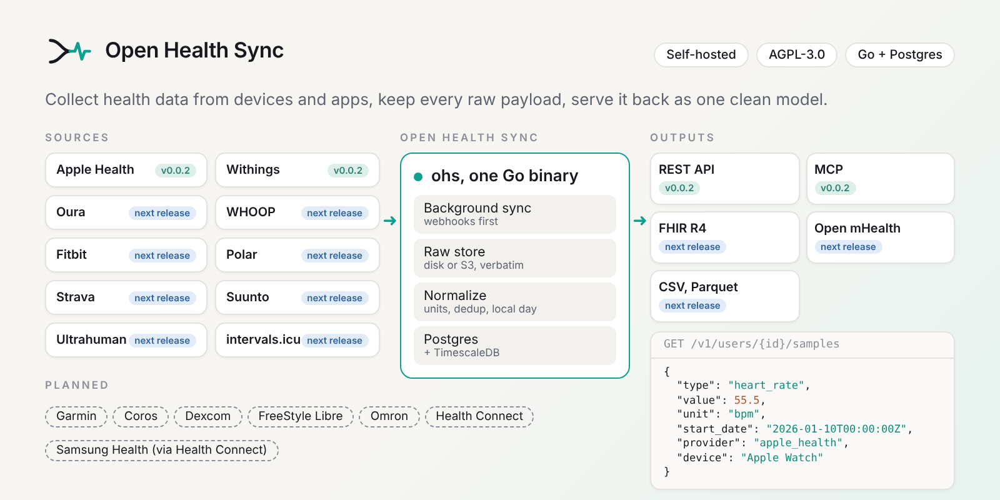
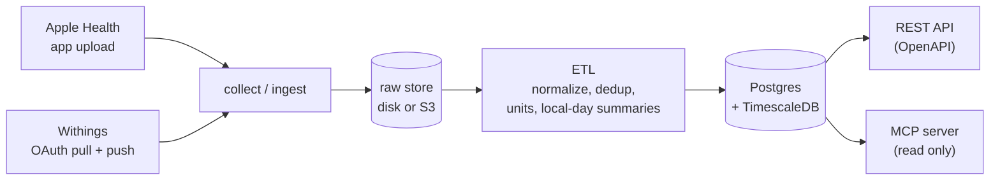

<a href="#quickstart">
<picture>
  <source media="(prefers-color-scheme: dark)" srcset="docs/assets/readme/hero-dark.png">
  
</picture>
</a>

<div align="center">

# Open Health Sync

**Health data from devices and apps, in one clean model.** Self-hosted, free, one Go binary plus Postgres.

[](https://github.com/soma-intelligence/open-health-sync/actions/workflows/ci.yml)
[](https://github.com/soma-intelligence/open-health-sync/releases)
[](https://github.com/soma-intelligence/open-health-sync/releases)

[](go.mod)
[](LICENSE)

```bash
docker pull ghcr.io/soma-intelligence/open-health-sync:0.0.2
```

[**Quickstart**](#quickstart) &nbsp;&middot;&nbsp; [Why](#why) &nbsp;&middot;&nbsp; [Features](#features) &nbsp;&middot;&nbsp; [How it works](#how-it-works) &nbsp;&middot;&nbsp; [MCP](#connect-an-ai-agent-mcp) &nbsp;&middot;&nbsp; [FAQ](#faq)

<sub><b>v0.0.2, early preview.</b> APIs, configuration and schema may change in any 0.x release.</sub>

</div>

Open Health Sync (`ohs`) is a self-hosted ingestion and normalization layer for health data. It
pulls from providers, accepts uploads from phones, stores each payload verbatim, maps it to one
canonical model with one set of units, and serves it over a REST API and a read-only MCP server.
It is not a dashboard, a coaching app or a hosted service, and it is not a medical device or
clinical software.

## Why

Every health source speaks its own dialect. Apple Health sends one JSON line per HealthKit
sample, heart rate in `count/min`, oxygen saturation as a fraction. Withings sends a daily
activity object keyed by date, and intraday series keyed by Unix epoch. Each one has its own
idea of a day, a device and a duplicate.

So teams write a script per provider: a parser, a table, a cron job. It works until the second
provider, the first re-sent upload, the first mapper bug that needs a backfill, or the first
person who asks you to delete everything you hold about them.

Open Health Sync is that layer, written once, with the boring parts done properly.

<picture>
  <source media="(prefers-color-scheme: dark)" srcset="docs/assets/readme/before-after-dark.png">
  
</picture>

| | DIY script per provider | Open Health Sync |
| --- | :---: | :---: |
| Add a source | a new parser, new tables, a new cron job | a connector that maps into the same model |
| Units | whatever each API sends | one unit per quantity, the original value and unit kept in `metadata` |
| "Today" | UTC, or the provider's clock | the local calendar day of the record's time zone |
| A re-sent upload | stored twice | answered `200` with `"duplicate": true`, records de-duplicated by content hash |
| Raw payloads | parsed, then thrown away | kept verbatim on disk or S3, so a user can be re-processed after a fix |
| Is it done? | guess, or check the logs | `GET /coverage`: `pending_jobs`, `parked_jobs`, `rejected_records` |
| A crash mid-run | rerun the script and hope | Postgres queue, retries with backoff, parked after 5 attempts |
| Provider OAuth tokens | a plain column or a `.env` | sealed with AES-256-GCM under `OHS_ENCRYPTION_KEY` |
| Delete a user | grep across tables and buckets | `DELETE /v1/users/{id}`, then poll `GET /v1/deletions/{job_id}` |
| Let an AI agent read it | build an integration | read-only MCP server, `ohs mcp` for desktop agents |

## Features

- **One canonical model.** Quantity samples, category samples, sleep sessions and phases,
  workouts and routes, nutrition, daily summaries. Each record carries its provenance:
  `provider`, `source`, `device` and `ingested_at`.
- **One unit per quantity.** Quantity names come with UCUM units and LOINC codes
  ([data model](docs/data-model.md)). Heart rate is `bpm` whatever the source called it.
- **Raw payloads are kept.** Every upload and pull lands in the raw store (local folder or any
  S3 compatible bucket) before anything else, and is never rewritten. After a mapper fix, any
  user can be re-processed from the raw files ([how](docs/self-hosting.md#operating-notes)).
- **Local days, not UTC days.** Daily summaries are per local calendar day, from the record's
  time zone. When a provider sends no daily summary, step, energy and distance totals are
  derived from samples.
- **Idempotent uploads.** Each Apple Health part is stored under its day, batch and part
  number. Re-sending the same bytes answers `200` with `"duplicate": true`; other bytes under a
  taken key are refused, never written over. Records are de-duplicated by content hash.
- **Know when it's processed.** The coverage report counts records per provider and local day,
  plus jobs still pending, jobs parked after their retries, and lines that were not stored.
- **Real erasure.** `DELETE /v1/users/{id}` removes the user's raw files and every row, then the
  user. Not a soft flag. `OHS_RETENTION_DAYS` drops raw files and normalized data past an age.
- **Multi-tenant.** Tenant API keys (`ohs_sk_`) for your server, short-lived scoped user tokens
  (`ohs_ut_`, scopes `upload` and `read`) for one person's app or agent. Keys and tokens are
  stored as SHA-256 hashes.
- **Read-only MCP for AI agents.** A person can point their own agent at their own data, with a
  token that can only read.
- **One binary plus Postgres.** The queue lives in Postgres (`FOR UPDATE SKIP LOCKED`). No
  message broker, cache or worker fleet. The `api`, `collect` and `etl` roles run in one
  process or apart.
- **Runs small.** A Raspberry Pi 5 with 4 GB runs the full stack, with a compose overlay tuned
  for it.
- **Open standards.** An OpenAPI 3.1 file describes the API, MCP is an open protocol, and
  `ohs doctor` checks a configuration before you trust it.
- **No scores, no AI inside.** It stops at clean, traceable data. Build insights on top.

### Sources and outputs

Six sources are available. Every other one is planned: on the roadmap, not built yet.
Integration paths, vendor programs and tracking issues for each:
[docs/connectors](docs/connectors/README.md).

| Source | Status | How the data arrives |
|---|---|---|
| Apple Health | ✅ Available | your iOS app uploads HealthKit data ([contract](docs/connectors/apple-health.md)) |
| Withings | ✅ Available, not yet verified with a real account | OAuth, scheduled pulls, push notifications ([guide](docs/connectors/withings.md)) |
| Oura | ✅ Available, not yet verified with a real account | OAuth, scheduled pulls ([guide](docs/connectors/oura.md)) |
| Whoop | ✅ Available, not yet verified with a real account | OAuth, scheduled pulls, webhooks ([guide](docs/connectors/whoop.md)) |
| Strava | ✅ Available, not yet verified with a real account | OAuth, scheduled pulls, webhook events ([guide](docs/connectors/strava.md)) |
| Polar | ✅ Available, not yet verified with a real account | OAuth, scheduled pulls, webhooks ([guide](docs/connectors/polar.md)) |
| Garmin, Fitbit | 🛠 Planned ([#9](https://github.com/soma-intelligence/open-health-sync/issues/9)) | partner program (Garmin); Fitbit Web API moving to the Google Health API |
| Ultrahuman, Suunto | 🛠 Planned | partner programs |
| Coros, Dexcom | 🛠 Planned | cloud API, OAuth |
| FreeStyle Libre, Omron | 🛠 Planned | not researched yet |
| Health Connect | 🛠 Planned | on-device, through the planned Kotlin SDK |
| Samsung Health, Zepp / Amazfit | 🛠 Planned, via Health Connect | their apps write to Health Connect on Android |
| Google Fit | Deprecated by Google | use Health Connect (planned Kotlin SDK) |
| Eight Sleep | No public API | nothing official to build on |

Want one sooner? Connectors are self-contained: read
[writing a connector](docs/writing-a-connector.md) and pick a
[good first issue](https://github.com/soma-intelligence/open-health-sync/issues?q=is%3Aissue%20is%3Aopen%20label%3A%22good%20first%20issue%22).

| Output | Status |
|---|---|
| REST JSON, described by [api/openapi.yaml](api/openapi.yaml) | ✅ Available |
| MCP server, read only ([docs/mcp.md](docs/mcp.md)) | ✅ Available |
| Read routes for ECG recordings and heartbeat (RR) series, which are stored today | 🛠 Planned |
| Outgoing webhooks, FHIR R4, Open mHealth, CSV and Parquet exports | 🛠 Planned |
| SDKs: Swift, Kotlin, React Native, Flutter | 🛠 Planned |

## Quickstart

You need Docker with Compose v2.24 or later, plus `curl`, `jq` and `openssl`. Compose pulls the
published image `ghcr.io/soma-intelligence/open-health-sync` (amd64 and arm64).

```sh
git clone https://github.com/soma-intelligence/open-health-sync.git && cd open-health-sync
cp .env.example .env
sed -i.bak "s|^OHS_ENCRYPTION_KEY=.*|OHS_ENCRYPTION_KEY=$(openssl rand -base64 32)|" .env
docker compose --env-file .env -f deploy/docker-compose.yml up -d --wait
docker compose --env-file .env -f deploy/docker-compose.yml exec ohs /ohs admin tenant create --name dev
```

The last command prints a tenant API key once. Keep it:

```sh
export OHS=http://localhost:8080
export KEY=ohs_sk_...    # the key printed above
```

Port 8080 taken? Set `OHS_HTTP_PORT` and a matching `OHS_PUBLIC_URL` in `.env` (see
[self-hosting](docs/self-hosting.md#port-and-a-second-install)).

Create an end user and a token the user's app would hold:

```sh
USER_ID=$(curl -s -X POST $OHS/v1/users -H "Authorization: Bearer $KEY" \
  -H 'Content-Type: application/json' -d '{"external_ref":"demo"}' | jq -r .id)
TOKEN=$(curl -s -X POST $OHS/v1/users/$USER_ID/tokens -H "Authorization: Bearer $KEY" \
  -H 'Content-Type: application/json' -d '{"scopes":["upload"]}' | jq -r .token)
```

Upload one Apple Health part (one heart rate reading, gzip compressed):

```sh
DAY=$(date -u +%Y-%m-%d); NOW=$(date -u +%Y-%m-%dT%H:%M:%SZ)
printf '{"quantityType":"HKQuantityTypeIdentifierHeartRate","startDate":"%s","endDate":"%s","value":72,"unit":"count/min","sourceName":"Demo Watch","metadata":{"HKTimeZone":"UTC"}}\n' "$NOW" "$NOW" \
  | gzip | curl -s -X POST $OHS/v1/ingest/apple-health \
    -H "Authorization: Bearer $TOKEN" -H "Content-Type: application/gzip" \
    -H "X-OHS-Type: HKQuantityTypeIdentifierHeartRate" -H "X-OHS-Day: $DAY" \
    -H "X-OHS-Batch: demo1" -H "X-OHS-Part: 0" --data-binary @-
```

Wait until processing is done (`pending_jobs` is 0), then read the normalized sample back:

```sh
curl -s "$OHS/v1/users/$USER_ID/coverage" -H "Authorization: Bearer $KEY"
curl -s "$OHS/v1/users/$USER_ID/samples?type=heart_rate" -H "Authorization: Bearer $KEY"
```

`ohs doctor` checks the configuration at any time:
`docker compose --env-file .env -f deploy/docker-compose.yml run --rm ohs doctor`.
Data lives in the `pgdata` and `raw` volumes; `docker compose ... down` keeps them.

## How it works



1. **Collect.** Your iOS app posts HealthKit data to `POST /v1/ingest/apple-health` as gzip
   NDJSON parts, with a user token that has the `upload` scope and the headers `X-OHS-Type`,
   `X-OHS-Day`, `X-OHS-Batch` and `X-OHS-Part`. Withings is pulled on a schedule and when it
   sends a notification to `/inbound/withings`.
2. **Keep the raw payload.** The part is written to the raw store first, then a job is queued in
   Postgres. The answer names the raw key and whether the part was a duplicate.
3. **Normalize.** The `etl` role maps each line to the canonical model, converts units, drops
   duplicates, attributes source and device, and rolls up daily summaries per local day.
4. **Serve.** Reads are `GET /v1/users/{id}/...` with the tenant key, paged with a cursor. The
   MCP server reads the same data, read only.

Details: [architecture](docs/architecture.md), [API guide](docs/api.md).

### See it run

These are real captures, not mockups: `ohs` 0.0.1 built from this repository, run natively
against TimescaleDB (on port 8088, since 8080 was taken on that machine), with the end to end
Apple Health fixture in [`connectors/applehealth/testdata/e2e`](connectors/applehealth/testdata/e2e)
uploaded as six parts. The fixture's values are synthetic.

<picture>
  <source media="(prefers-color-scheme: dark)" srcset="docs/assets/readme/doctor-dark.png">
  
</picture>

A sample comes back in canonical units, with what the provider sent kept in `metadata`
(`count/min` became `bpm`):

<picture>
  <source media="(prefers-color-scheme: dark)" srcset="docs/assets/readme/samples-dark.png">
  
</picture>

Daily summaries are derived per local day, and the coverage report says when processing is done:

<picture>
  <source media="(prefers-color-scheme: dark)" srcset="docs/assets/readme/daily-coverage-dark.png">
  
</picture>

<picture>
  <source media="(prefers-color-scheme: dark)" srcset="docs/assets/readme/chart-dark.png">
  
</picture>

## Connect an AI agent (MCP)

Mint a user token with only the `read` scope (it may live up to 30 days):

```sh
curl -s -X POST $OHS/v1/users/$USER_ID/tokens -H "Authorization: Bearer $KEY" \
  -H 'Content-Type: application/json' -d '{"scopes":["read"],"ttl_seconds":2592000}'
```

Then add `ohs mcp` (stdio) to your desktop agent's `mcpServers`:

```json
{
  "mcpServers": {
    "open-health-sync": {
      "command": "/usr/local/bin/ohs",
      "args": ["mcp"],
      "env": { "OHS_MCP_URL": "http://localhost:8080", "OHS_MCP_KEY": "ohs_ut_..." }
    }
  }
}
```

`ohs mcp` holds no data and needs no database: it forwards each message to the `/mcp` endpoint
of an instance. `OHS_MCP_URL` must be `https` unless the host is loopback. Agents that speak
Streamable HTTP can call `/mcp` directly with the bearer token.

<picture>
  <source media="(prefers-color-scheme: dark)" srcset="docs/assets/readme/mcp-dark.png">
  
</picture>

Tools, arguments and paging: [docs/mcp.md](docs/mcp.md).

## Data model

Every source maps into these records (see [docs/data-model.md](docs/data-model.md) for fields
and units):

- **QuantitySample**: one scalar measurement, such as heart rate, steps or SpO2.
- **CategorySample**: a categorical event, such as a stand hour or a menstrual flow entry.
- **SleepSession** and **SleepPhase**: a night with its duration breakdown, then each stage.
- **Workout** and **RoutePoint**: a session with its metrics, then its GPS track.
- **NutritionLog**: a food or drink entry with its nutrients.
- **ECGRecording** and **ECGVoltageSample**: the recording's metadata, then the voltage trace.
  Stored, not served yet: the read route is planned.
- **HeartbeatSample**: one beat-to-beat (RR) interval. Stored, not served yet: the read route is
  planned.
- **DailySummary**: totals per local day, from the provider or rolled up from samples.
- **Observation**: a generic coded fact for the long tail. No connector writes it yet.

## Deploy

- **Compose with the published image.** `deploy/docker-compose.yml`, as in the quickstart. Pin
  the tag with `OHS_VERSION` (there is no `latest` while 0.x). See
  [self-hosting](docs/self-hosting.md).
- **Raspberry Pi 5.** Add the overlay `deploy/docker-compose.pi.yml` (smaller Postgres buffers,
  memory limits). See [Raspberry Pi 5](docs/self-hosting.md#raspberry-pi-5-4-gb).
- **S3 raw store.** Add `deploy/docker-compose.s3.yml`, or point `OHS_RAW_STORE` at any S3
  compatible bucket. See [S3](docs/self-hosting.md#s3-compatible-raw-store).
- **Release binaries.** Linux and macOS, amd64 and arm64, with `checksums.txt`, on the
  [releases page](https://github.com/soma-intelligence/open-health-sync/releases). Bring your
  own Postgres with TimescaleDB and run `ohs up` (migrate, then serve). The macOS binaries are
  not signed yet: clear the quarantine flag with `xattr -d com.apple.quarantine ohs`.
- **Build from source.** Go 1.26: `make build` gives `bin/ohs`. For compose, add
  `deploy/docker-compose.build.yml`, which needs `docker buildx`; without it, see
  [build from source](docs/self-hosting.md#build-from-source).

## FAQ

**Who sees my data?**
Only whoever runs the instance. Open Health Sync is self-hosted software, not a service: there
is no account to create with us, no analytics and no call home. The server talks to the
providers you enable (Withings, when you set its keys) and to your own database and raw store.
Logs never contain tokens, keys or health values.

**Where does the data live?**
In two places you control: Postgres with TimescaleDB (connections and jobs in the `ohs_sync`
schema, normalized records in `ohs_data`) and the raw store, a local folder or an S3 compatible
bucket. With compose, those are the `pgdata` and `raw` volumes. Back them up together, with
`OHS_ENCRYPTION_KEY`.

**Is it HIPAA or GDPR compliant?**
No software is compliant on its own, and Open Health Sync is not certified, audited or covered
by a business associate agreement. What it gives you: data stays on infrastructure you choose,
`DELETE /v1/users/{id}` is a hard delete of raw files and rows (useful for erasure requests),
`OHS_RETENTION_DAYS` enforces a retention period, every query is scoped to a tenant and a user,
keys and tokens are stored hashed, and provider OAuth tokens are encrypted with AES-256-GCM.
Health records themselves are not encrypted by `ohs`: use disk or database encryption, TLS in
front of the API, and your own access controls. Whether a deployment meets HIPAA, GDPR or any
other rule depends on how you run it.

**What does it cost?**
Nothing. The server is free and open source. You pay for wherever you run it, which can be a
Raspberry Pi 5 with 4 GB. Withings and Oura each need your own developer application,
registered with the vendor.

**Which devices does it work with?**
Anything that writes to Apple Health (Apple Watch, iPhone, and the apps and devices that sync
into HealthKit), through an iOS app that uploads it. No SDK ships yet: your app implements the
[upload contract](docs/connectors/apple-health.md). Withings scales, watches and sleep devices
through the user's Withings account. Oura rings, WHOOP bands, Polar watches and Strava activities
work through the user's own account with each; these connectors are available but not yet
verified with a real account. Garmin, Fitbit, Samsung Health through Health Connect and more are
[planned](docs/connectors/README.md), not available yet, and the
[connector request form](https://github.com/soma-intelligence/open-health-sync/issues/new/choose)
is open.

**Why AGPL?**
So the layer stays open. Anyone can run, study and change it; if you run a modified Open Health
Sync as a network service, you publish your changes under the same license. The client SDKs will
be MIT licensed when they exist, so apps that talk to a server are not affected.

**Can I use it commercially?**
Yes. A company can run it, unmodified or modified, to power its own product. The AGPL only asks
that users who interact with a modified server over the network can get its source. This is not
legal advice: read [LICENSE](LICENSE) or ask your counsel.

**Is it a medical device?**
No. It moves and normalizes data. It does not diagnose, score or advise, and it is not clinical
software.

## Status and roadmap

v0.0.2 is the latest release. What changed: [CHANGELOG.md](CHANGELOG.md). Install notes and
the full list of limitations: [release notes](docs/release-notes/v0.0.2.md).

Known limitations:

- After a hard kill, a job that was in flight is picked up again only after its 10 minute
  visibility timeout.
- One database and one raw store per instance; no multi-region replication.
- No FHIR, webhooks or mobile SDKs yet.
- The Withings portal steps and the units of physical effort and VO2 max are not verified on
  real devices yet.
- `/metrics` is unauthenticated: block it at your proxy or set `OHS_METRICS=false`.

Next: more connectors, standard outputs (FHIR R4, Open mHealth, exports, webhooks), then client
SDKs. Requests are welcome as GitHub issues, including the connector request form.

## Documentation

- [Self-hosting](docs/self-hosting.md): configuration, images, Raspberry Pi, S3, operating notes.
- [API guide](docs/api.md) and the [OpenAPI file](api/openapi.yaml), the source of truth.
- [MCP server](docs/mcp.md): tools, credentials, desktop and remote agents.
- [Data model](docs/data-model.md): every canonical type and quantity name, with units.
- [Architecture](docs/architecture.md): roles, pipeline, storage, reliability.
- Connectors: [supported and planned sources](docs/connectors/README.md),
  [Apple Health](docs/connectors/apple-health.md),
  [Withings](docs/connectors/withings.md), [Strava](docs/connectors/strava.md), [writing your own](docs/writing-a-connector.md).

## Contributing

Issues and pull requests are welcome. Read [CONTRIBUTING.md](CONTRIBUTING.md) and the
[code of conduct](CODE_OF_CONDUCT.md). To add a provider, start with
[writing a connector](docs/writing-a-connector.md).

```sh
make setup        # git hooks
make build        # bin/ohs
make test         # unit tests
make integration  # needs Docker (testcontainers)
```

## Security

Report vulnerabilities privately, as described in [SECURITY.md](SECURITY.md). Never paste health
data, keys or tokens in a public issue.

## License

The server is AGPL-3.0-only, see [LICENSE](LICENSE). If you run a modified Open Health Sync as a
service, you publish your changes. The client SDKs will be MIT licensed when they exist.
