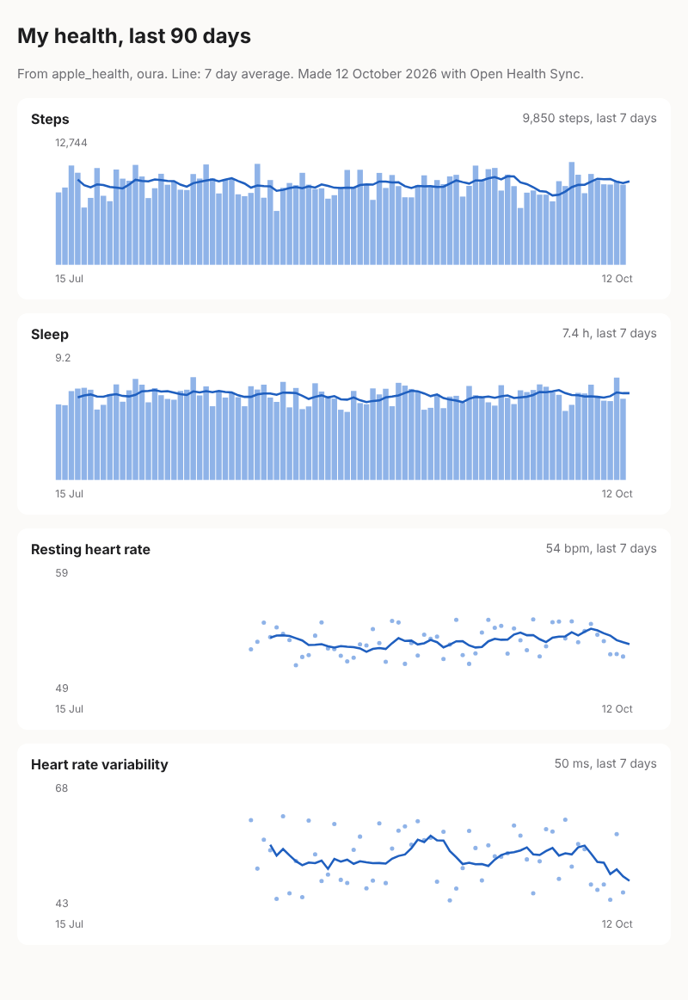

# Dashboard

One page with your steps, sleep, resting heart rate and HRV over the last three months, every
device together. It is a single HTML file with no script and nothing loaded from the internet:
open it, keep it, print it.

```sh
go run ./recipes/dashboard                    # last 90 days, writes health-dashboard.html
go run ./recipes/dashboard -days 365 -out year.html
```



Bars and dots are days; the line is the 7 day average. Hover a day for its value. The page
follows your system's light or dark mode.

The file holds your health data. Share it with care.

## How it works

It reads `GET /v1/users/{id}/daily` (steps, resting heart rate, HRV) and
`GET /v1/users/{id}/sleep`, picks for each chart the source that reports it on the most days,
and draws the charts as inline SVG in Go, with no library.

## Make it yours

- Add a chart: copy one `chart(...)` line and give it another daily field, such as `active_kcal`.
- Serve it: write the file into a folder your home server publishes, from cron each morning.
